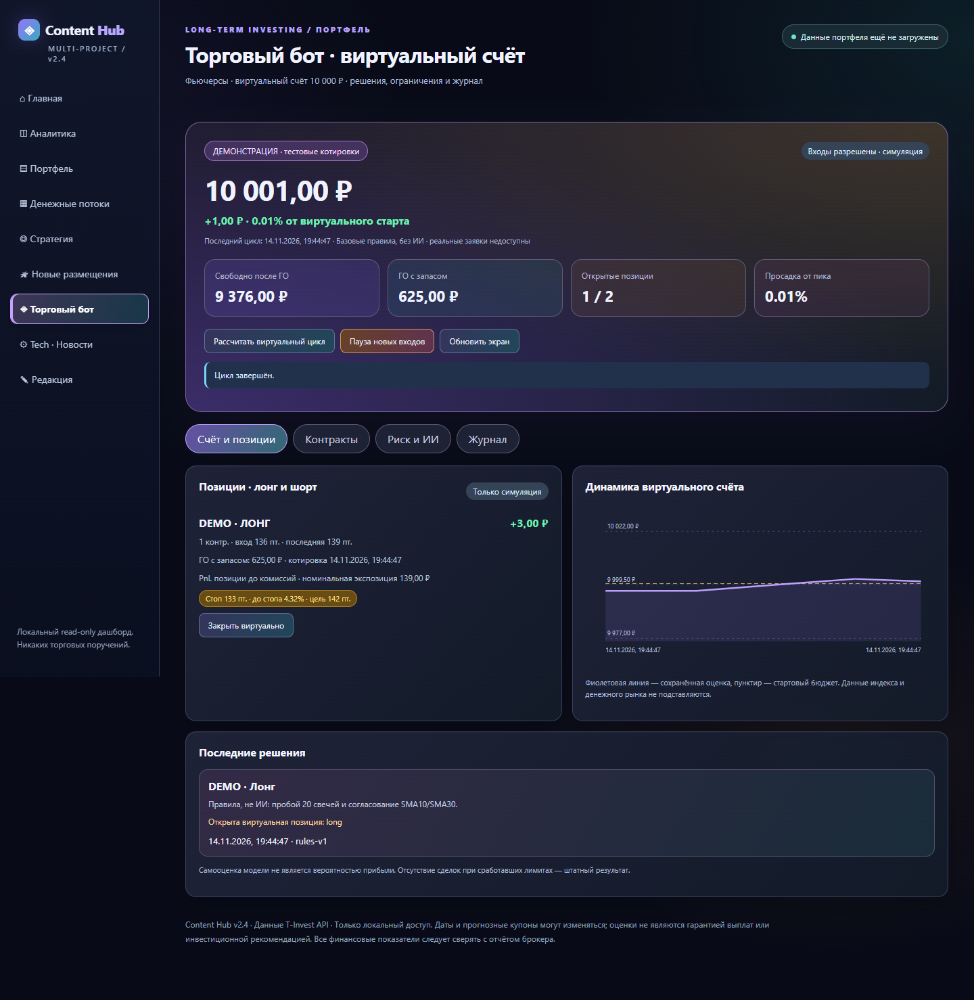
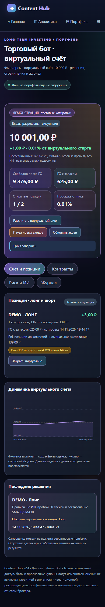

# Торговый бот · виртуальные фьючерсы

В хабе появился раздел **Торговый бот**: отдельный виртуальный счёт на **10 000 ₽**, позиции, стопы, цели, динамика капитала и журнал решений. История хранится в SQLite вместе с данными хаба и переживает закрытие браузера и перезапуск компьютера. Реальные средства и ИИС не используются. В коде нет отправки брокерских заявок и переключателя реальной торговли.

## Первый запуск на Windows

Из папки `C:\Projects\Invest-Blog-Assistant`:

```powershell
.\hub web
.\hub trade-start
.\hub trade-status
# Остановить только виртуальный торговый процесс:
.\hub trade-stop
```

Веб-сервер после обновления нужно перезапустить. Фоновый процесс проверяет рынок каждые 5 минут, пока компьютер включён. Закрытие браузера его не останавливает; сон и выключение компьютера останавливают расчёты. После включения снова выполните `trade-start`. Автозапуск Windows не устанавливается. Процесс публикации новостей работает отдельно.

В разделе **Контракты** найдите и добавьте конкретный фьючерс: проверьте тикер и срок исполнения. Список изначально пуст. Подключение использует существующий `TINVEST_TOKEN` только для чтения рыночных данных. Перед включением расчётов проверьте настройки риска и стоимость комиссии вашего тарифа.

## Grok

**Текущий основной вариант — Grok через коннектор, без xAI API.** В хабе подготовь данные и отправь скопированный запрос в Grok. Решение возвращается в хаб для проверки риска и виртуального исполнения. [Настройка коннектора на Windows](GROK_CONNECTOR.md). Ниже описана оставшаяся альтернативная интеграция через платный API.

Первым подготовлен адаптер **xAI API**. Коннектор Grok и подписка на приложение не заменяют ключ и баланс API. Доступность аккаунта и региона нужно проверить у xAI; доступ из России не подтверждён.

Добавьте в локальный `.env` (ключ не отправляйте в чат и не сохраняйте в Git):

```dotenv
TRADING_AI_PROVIDER=xai
TRADING_AI_MODEL=grok-4.7
XAI_API_KEY=ваш_ключ_xai
```

Перезапустите веб-сервер и виртуальный процесс (`trade-stop`, затем `trade-start`). В настройках нажмите **Проверить xAI**: это получение списка моделей без генерации. Если выбранная модель недоступна аккаунту, укажите доступный идентификатор в `.env` и снова перезапустите процессы. Проверка списка моделей сама по себе не подтверждает наличие средств для генерации.

Выберите стратегию ИИ, добавьте контракты и включите новые входы. Кнопка ручного цикла выполняет тот же анализ, что фоновый процесс. Без ключа ИИ не работает. На момент разработки реальная генерация Grok не проверена: ключ отсутствовал. Проверены формат запросов, обработка ошибок и валидация ответов с подменённым транспортом.

Модель получает числовые признаки рынка и виртуальную позицию, предлагает `long`, `short`, `close` или `hold` с объяснением. Реальные номера счетов и балансы не передаются. Размер позиции и допустимость сделки рассчитывает независимый модуль риска. Самооценка модели не является вероятностью успеха. Не более 24 попыток генерации в день, до 1000 выходных токенов на запрос; это ограничение количества, а не денежного расхода. На одной завершённой свече решение не запрашивается повторно, в том числе после ошибки API.

Для проверки механики без платного API доступна стратегия **Правила**: пробой 20 свечей с SMA10/SMA30. Это не ИИ и не подтверждённая прибыльная стратегия. Подготовлены также сменные адаптеры Yandex и локального Ollama; их реальные подключения не проверялись.

Подписка ChatGPT Plus не даёт обычного API-ключа или включённого API-баланса. Официальный Sign in with ChatGPT допускается в подходящих интеграциях при выполнении условий OpenAI; здесь такой вход не реализован. Россия отсутствует в списке поддерживаемых стран OpenAI API.

## Учёт и ограничения симулятора

- Сигналы используют только завершённые 15-минутные свечи. Устаревшие котировки, закрытый рынок, неполные данные и приближающееся исполнение контракта блокируют новые входы. Автоматического переноса на следующий контракт нет.
- Прибыль фьючерса: изменение цены / шаг цены × стоимость шага × количество × направление. Переоценка ведётся по последовательно полученным ценам и текущей стоимости шага. Это упрощённый учёт вариационной маржи, без воспроизведения всех клиринговых расчётов и изменения валютного курса между пропущенными наблюдениями.
- Гарантийное обеспечение резервируется, а не списывается как цена акции. Берётся биржевое обеспечение отдельно для лонга и шорта с буфером 25%; персональные требования брокера могут отличаться. Поддерживаются рублёвое обеспечение и лот 1.
- Начальные лимиты: риск 1% капитала на сделку, дневной убыток 3%, просадка 10%, обеспечение до 30% капитала, максимум 2 позиции по 1 контракту. Недостаточный бюджет приводит к отказу, а не принудительному открытию одного контракта.
- Комиссия по умолчанию — **оценка 2 ₽ за контракт за сторону**; замените своей. Проскальзывание — 1 шаг. Стоп основан на 2 ATR, цель — 2 расстояния до стопа. При скачке цены выход рассчитывается по наблюдаемой цене с проскальзыванием, а не по идеальной цене стопа.
- Пауза запрещает новые входы. При работающем процессе переоценка и виртуальные защитные выходы продолжаются. При устаревших данных сохраняется последняя оценка. При выключенном компьютере защитных проверок нет.
- Ручное закрытие относится только к виртуальной позиции. Начальный бюджет нельзя менять после первой виртуальной сделки. График строится из сохранённых наблюдений; вымышленного индекса или бэктеста нет.

Для перехода к реальным сделкам потребуется отдельная реализация исполнения, сверки заявок и позиций, клиринга, восстановления после сбоев и отдельное решение пользователя. Эта версия такой возможности не содержит.

## Проверки и внешний вид

```powershell
.\hub test
```

Тесты проверяют расчёт длинных и коротких позиций, гэпы, комиссии, риск, конкурентные циклы и паузу во время анализа, защиту изменений и запрет брокерских методов исполнения. Браузерный сценарий `tests/browser_trading.cjs` рассчитан на отдельный тестовый сервер с демонстрационными котировками, а не рабочую базу.

На изображениях ниже **вымышленные котировки и виртуальные сделки**:




## Документация провайдеров

- [xAI: начало работы](https://docs.x.ai/developers/quickstart), [тарифы](https://docs.x.ai/developers/pricing).
- [Т-Инвестиции: пункты и стоимость шага](https://developer.tbank.ru/invest/intro/useful-info/points).
- [OpenAI: Sign in with ChatGPT](https://developers.openai.com/siwc/quickstart), [поддерживаемые страны API](https://developers.openai.com/api/docs/supported-countries).
